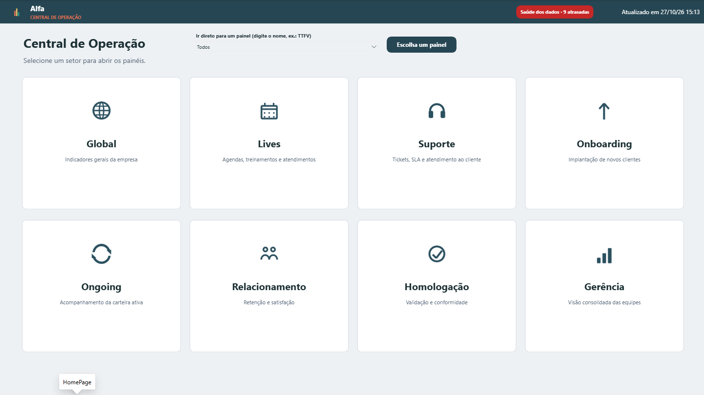

# Painel Operacional — modelo em Power BI

Um painel de operação completo para uma empresa de software por assinatura (SaaS): **56 páginas**, **8 setores**,
**cerca de 450 medidas**, segurança por setor e regras de negócio documentadas. Tudo roda sobre **uma planilha de
dados fictícios**, então dá para abrir, explorar e adaptar sem acesso a nenhum banco.

> A empresa (Alfa), os produtos (Alfa e Kappa), pessoas, clientes, CNPJs e valores são inventados.

## O que tem aqui

| Item | Para quê |
|---|---|
| `Painel Operacional.pbip` | Abre o projeto no Power BI Desktop |
| `Painel Operacional.Report/` | As páginas e os visuais (formato PBIR: um JSON por visual) |
| `Painel Operacional.SemanticModel/` | O modelo: tabelas, relações, medidas e segurança (formato TMDL) |
| `dados/dados_exemplo.xlsx` | A fonte de tudo: uma aba por tabela, cerca de 250 mil linhas fictícias |
| `GUIA-PARA-IA.md` | Guia técnico completo para quem (pessoa ou IA) for manter o painel |
| `imagens/` | Prints de 12 telas, já com os dados fictícios carregados |

## Os setores

- **Gerência**: cohorts por produto, inativações, resumos dos setores.
- **Global** (aberto a todos): cancelamentos, churn financeiro, alteração de receita, carteiras, idade dos clientes,
  tempo até o primeiro valor (TTFV), migrações.
- **Lives**: participação, desempenho, clientes e satisfação das lives.
- **Suporte**: resultados, CSAT, atendimentos e empresas atendidas.
- **Onboarding** e **Ongoing**: performance por pessoa, No Show, cancelamentos, SLA das atividades, migrações,
  ligações, últimos contatos e WhatsApp (atendimentos, templates, volumetria).
- **Relacionamento**: cancelamentos, reversões, Ouvidoria, clientes e reversão × concessões.
- **Homologação**: entregas de app e de guias, CSAT, tempo de entrega.

## Como abrir

1. Use o **Power BI Desktop** atualizado (o formato PBIR precisa de uma versão de 2025 em diante).
2. Abra `Painel Operacional.pbip`.
3. Em **Transformar dados → Editar parâmetros**, aponte `CaminhoPlanilha` para o caminho completo de
   `dados/dados_exemplo.xlsx` na sua máquina.
4. Clique em **Atualizar**. A primeira carga leva alguns minutos.

O painel abre na Home: cada card leva a um setor, e as abas no topo de cada tela levam às outras telas do setor. No
Desktop você vê tudo; publicado, cada pessoa vê só os setores das equipes dela (RLS, segurança por linha).

Os dados fictícios vão até **26/10/2026**. A tela **Saúde dos dados** compara a data de cada fonte com o dia de hoje,
então, abrindo depois disso, as fontes aparecem como atrasadas e o selo da Home fica vermelho: é o comportamento
esperado com dados parados, não um erro.

## Como usar com os seus dados

Cada aba da planilha tem exatamente as colunas que o painel espera. Você pode:
- **substituir o conteúdo das abas** pelos seus dados, mantendo os cabeçalhos; ou
- **trocar a consulta de uma tabela** por um banco ou API, desde que ela devolva as mesmas colunas.

O `GUIA-PARA-IA.md` explica cada tabela, cada regra de negócio e as armadilhas do formato.

## Destaques do projeto

- **Equipe do mês**: cada número conta para a equipe em que a pessoa estava naquele mês; quem muda de equipe não
  altera os meses passados.
- **Uma data por tipo de número** (fechamento, criação, avaliação, conclusão), sempre num único filtro de período.
- **Segurança em camadas**: quem abre o painel, qual setor cada pessoa vê, cadeado e navegação na Home, e os
  números filtrados por linha.
- **"Dados até" por tela** e uma tela de **Saúde dos dados** que diz se cada fonte está em dia.
- **Metas** lidas de tabelas de metas, com metas de quantidade derivadas da carteira do início do mês.
- **Padrões** em todas as telas: datas dd/mm/aa, duas casas decimais, números cheios, gráficos em ordem alfabética,
  "?" de ajuda em cada quadro.
